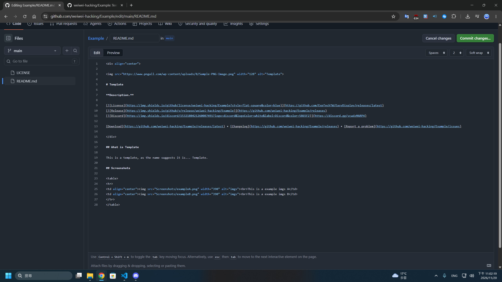
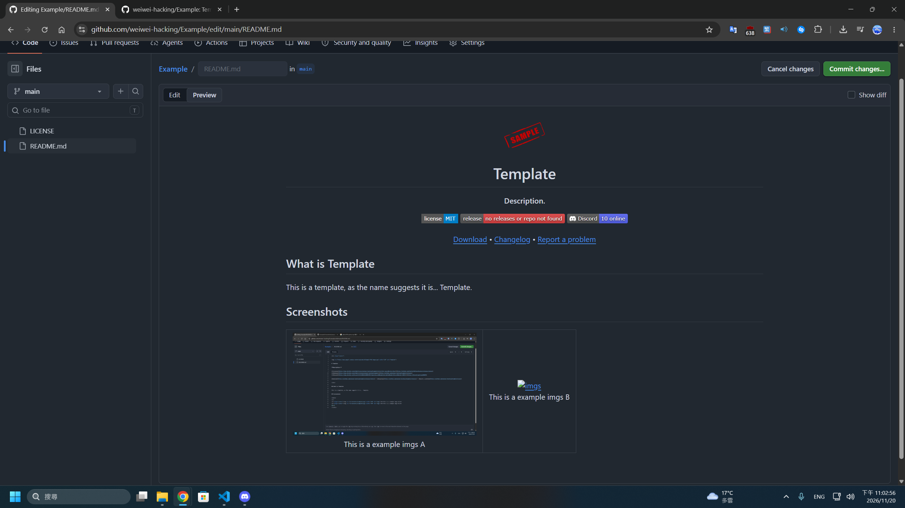
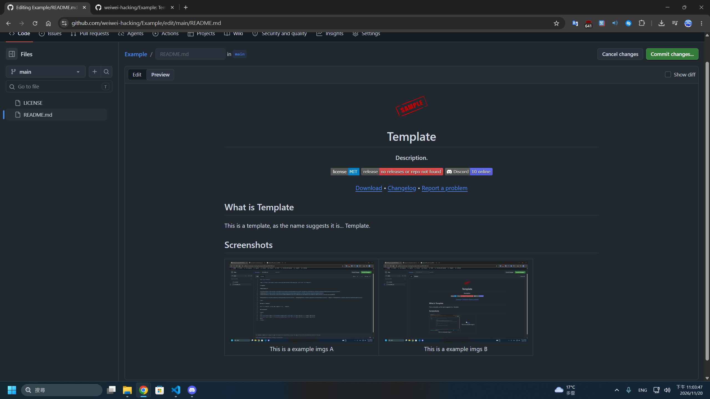

# Template

**Description.**

[Download](https://github.com/weiwei-hacking/Example/releases/latest) • [Changelog](https://github.com/weiwei-hacking/Example/releases) • [Report a problem](https://github.com/weiwei-hacking/Example/issues)

## What is Template

This is a template, as the name suggests it is... Template.

## Screenshots

<table>
<tr>
<td align="center"> This is a example imgs A</td>
<td align="center"> This is a example imgs B</td>
</tr>
<tr>
<td align="center"> This is a example imgs C</td>
</tr>
</table>

## Download

Template needs **system & software**.

1. Download `Template-<version>.xxx` from [Releases](https://github.com/weiwei-hacking/Example/releases/latest).
2. And.
3. Done.
